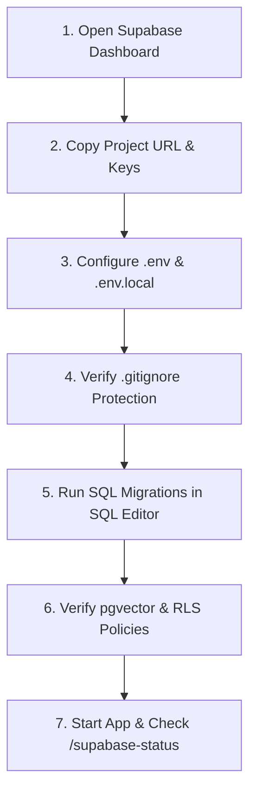

# Supabase Connection & Configuration Guide (ClassroomCare AI × NIU)

> [!IMPORTANT]
> **Credential Security Protocol:** Never paste your Supabase Service Role Key, Database Password, or secret tokens into public chats, AI conversations, or Git source control. The Supabase Service Role Key grants full admin access to bypass Row Level Security and must reside exclusively in local server-side configuration.

This step-by-step, beginner-friendly guide walks you through connecting your existing Supabase project to ClassroomCare AI for Noorul Islam Centre for Higher Education (NIU).

---

## 1. Prerequisites Checklist

Before you begin, ensure you have:
1. An active account on [https://supabase.com/](https://supabase.com/).
2. An existing Supabase project created for ClassroomCare AI.
3. Access to the Supabase web dashboard.
4. The ClassroomCare-App repository cloned locally.

---

## 2. Step-by-Step Connection Workflow



### Step 1: Open the Supabase Project Dashboard
1. Log in to [https://supabase.com/dashboard](https://supabase.com/dashboard).
2. Click on your project card to open its project overview.

### Step 2: Locate Project URL and API Keys
1. In the left navigation menu, click on the **Project Settings** (gear icon) at the bottom left.
2. Select **API** from the Configuration section.
3. Under **Project URL**, copy the URL (format: `https://<your-project-ref>.supabase.co`).
4. Under **Project API keys**:
   - **Publishable Key (`anon` / `public`):** Safe for browser use. Copy this key.
   - **Secret Key (`service_role`):** Privileged server key that bypasses RLS. Copy this key and keep it secret.

### Step 3: Configure Local Environment Variables
ClassroomCare AI uses a dual frontend/backend configuration pattern:

#### Root Environment File (`.env`)
Create or edit `.env` in the root directory `c:\Users\shameer\OneDrive\Documents\classroomcare-ai\ClassroomCare-App\.env`:
```bash
# Server & Environment
ENVIRONMENT=development
LOG_LEVEL=INFO
APP_NAME="ClassroomCare AI — NIU Facilities & Campus Operations"

# Supabase Server Settings (Never exposed to frontend)
SUPABASE_URL=https://<your-project-ref>.supabase.co
SUPABASE_SERVICE_ROLE_KEY=<your-secret-service-role-key>
SUPABASE_ANON_KEY=<your-public-anon-key>

# Direct Database Connection String (Optional, for CLI tools)
DATABASE_URL=postgresql://postgres:<your-db-password>@db.<your-project-ref>.supabase.co:5432/postgres

# Google Gemini API (Optional, for generative RAG assistance)
LLM_PROVIDER=mock
GEMINI_API_KEY=
```

#### Frontend Environment File (`apps/web/.env.local`)
Create or edit `apps/web/.env.local`:
```bash
# Frontend Supabase Credentials (Public Only)
VITE_SUPABASE_URL=https://<your-project-ref>.supabase.co
VITE_SUPABASE_PUBLISHABLE_KEY=<your-public-anon-key>

# Legacy alias supported automatically
VITE_SUPABASE_ANON_KEY=<your-public-anon-key>

VITE_API_URL=http://localhost:8000
```

> [!WARNING]
> **Strict Rule:** Never prefix `SUPABASE_SERVICE_ROLE_KEY` with `VITE_`. Any variable starting with `VITE_` is compiled into the public client JavaScript bundle.

### Step 4: Verify Git Ignore Protection
Confirm that credentials are not tracked by Git before committing:
```bash
git status --ignored
```
Verify that `.env` and `apps/web/.env.local` are listed under ignored files in `.gitignore`.

---

## 3. Applying Database Migrations

ClassroomCare AI includes four declarative SQL migrations in `supabase/migrations/`:

| Migration File | Description | Destructive? |
| :--- | :--- | :--- |
| `20261026000001_initial_schema.sql` | Campuses, buildings, rooms, assets, maintenance requests, work orders, audit logs. | No (Uses `CREATE TABLE IF NOT EXISTS`) |
| `20261026000002_pgvector_setup.sql` | `pgvector` extension and 768-dim vector embeddings table. | No (Uses `CREATE EXTENSION IF NOT EXISTS`) |
| `20261026000003_rls_policies.sql` | Campus-isolated Row Level Security policies for tickets and docs. | No (Safe policy declarations) |
| `20261026000004_seed_data.sql` | Verified NIU academic blocks and demo unverified user fixtures. | No (Uses `ON CONFLICT DO NOTHING`) |

### Manual Execution via Supabase SQL Editor:
1. In the Supabase Dashboard, click **SQL Editor** in the left sidebar.
2. Click **New query**.
3. Open `supabase/migrations/20261026000001_initial_schema.sql` in your code editor, copy the entire contents, paste into the query box, and click **Run**.
4. Repeat in sequential order for:
   - `20261026000002_pgvector_setup.sql`
   - `20261026000003_rls_policies.sql`
   - `20261026000004_seed_data.sql`

---

## 4. Verifying Tables and RLS Policies

1. In Supabase Dashboard, navigate to **Table Editor**:
   - Confirm tables appear: `campuses`, `buildings`, `rooms`, `assets`, `maintenance_requests`, `work_orders`, `knowledge_documents`, `document_chunks`, `notifications`, `audit_logs`.
2. Navigate to **Authentication -> Policies**:
   - Confirm that Row Level Security is **Enabled** (green badge) on `maintenance_requests`, `work_orders`, `knowledge_documents`, `notifications`, and `audit_logs`.
3. Navigate to **Database -> Extensions**:
   - Verify that `vector` (pgvector) is enabled.

---

## 5. Verification & Granular Health Diagnostics

Start the FastAPI backend and check the 6-phase connection diagnostic endpoint:
```bash
curl http://localhost:8000/supabase-status
```

Expected diagnostic payload:
```json
{
  "is_configured": true,
  "status": "CONFIGURED",
  "phases": {
    "phase_1_api_process": { "status": "PASS", "detail": "Uvicorn ASGI runtime operational on port 8000." },
    "phase_2_env_vars": { "status": "PASS", "detail": "Configured (URL: https://xyz...)" },
    "phase_3_endpoint_reachability": { "status": "PASS", "detail": "Reachable (HTTP 200)." },
    "phase_4_database_query": { "status": "PASS" },
    "phase_5_auth_session": { "status": "PASS" },
    "phase_6_write_read_roundtrip": { "status": "PASS" }
  }
}
```

---

## 6. Troubleshooting Common Issues

### Issue 1: Supabase Status reports "UNCONFIGURED"
- **Cause:** `.env` is missing in the workspace root, or variables are named incorrectly.
- **Solution:** Verify variable names match `SUPABASE_URL` and `SUPABASE_SERVICE_ROLE_KEY` exactly. Restart the uvicorn server.

### Issue 2: Extension "vector" cannot be created
- **Cause:** PostgreSQL version or database tier limitation.
- **Solution:** In Supabase Dashboard -> Database -> Extensions, search for "vector" and enable it manually via the toggle.

### Issue 3: RLS Policy Denies All Reads
- **Cause:** Query was executed with an anonymous client without an authenticated JWT or campus profile.
- **Solution:** Ensure test requests pass an authenticated token or use the backend service-role client for background synchronization.

### Issue 4: Gemini Status reports "BLOCKED"
- **Cause:** `GEMINI_API_KEY` is not present in `.env`.
- **Solution:** ClassroomCare AI automatically operates in offline deterministic mode. Add your API key to `.env` to enable generative model reasoning.
