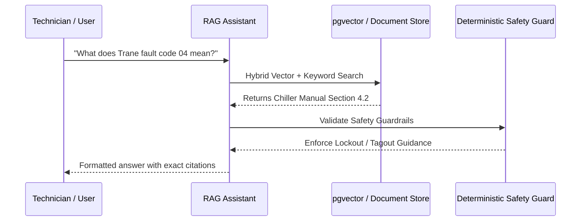

# ClassroomCare AI — Comprehensive User Guide & Operations Manual

**Platform:** ClassroomCare AI — Autonomous Classroom Maintenance & Intelligence Platform  
**Target Institution:** Noorul Islam Centre for Higher Education (NIU), Kumaracoil, Tamil Nadu, India  
**Official Portal:** [https://www.niuniv.com/](https://www.niuniv.com/)  
**Version:** 1.0.0 (macOS-Inspired Light-First Edition)

---

## Table of Contents
1. [Section A — Getting Started](#section-a--getting-started)
2. [Section B — Core Maintenance Workflows](#section-b--core-maintenance-workflows)
3. [Section C — AI & RAG Plain-English Guide](#section-c--ai--rag-plain-english-guide)
4. [Section D — Advanced Administration & Diagnostics](#section-d--advanced-administration--diagnostics)
5. [Section E — Interactive Troubleshooting Guide](#section-e--interactive-troubleshooting-guide)
6. [Section F — Interactive Onboarding Orientation](#section-f--interactive-onboarding-orientation)

---

## Section A — Getting Started

### 1. Platform Purpose & Scope
ClassroomCare AI is a high-availability facilities operations and maintenance intelligence platform built for educational institutions. Designed specifically for the campus topology of Noorul Islam Centre for Higher Education (NIU), the platform automates issue triage, coordinates technician dispatches, monitors service-level agreements (SLAs), and empowers maintenance engineers with verified technical manuals.

### 2. Primary Users
- **Students & Faculty:** Report equipment breakdowns, lighting failures, or HVAC issues in lecture halls and laboratories.
- **Assigned Field Technicians:** Access assigned work orders, view equipment diagnostic guides, itemize repair parts, and upload photo evidence.
- **Facilities Manager (Abishek):** Oversee campus-wide operations, triage work orders, assign personnel, and verify repairs before ticket closure.
- **Campus Safety Officers:** Monitor life-safety alerts, acknowledge emergency escalations, and review environmental health and safety (EHS) audit trails.
- **Campus Administrators:** Configure institutional settings, manage verified academic blocks, and adjust SLA policies.

### 3. Understanding Live vs. Demo Unverified Data
> [!NOTE]
> The persona **Abishek (Facilities Manager)** is currently an explicitly marked **Demo / Unverified Identity**. Production access requires provisioning an authenticated Supabase user account. The client role dropdown widget is a sandbox testing utility; real security boundaries are enforced server-side via Supabase JWT signatures and PostgreSQL Row Level Security (RLS).

---

## Section B — Core Maintenance Workflows

### 1. Submitting a Maintenance Ticket
1. Navigate to **Maintenance Requests** (`/tickets`) or click **New Request** in the header.
2. Select an official verified facility:
   - *Aeronautical & Aerospace Engineering Block (AERO)*
   - *Computer Science & Engineering Tech Block (CSE)*
   - *Allied Health Sciences Complex (AHS)*
   - *University Central Library (LIB)*
3. Select the room, category (HVAC, Electrical, Plumbing, AV/IT, Structural), and enter a factual description.
4. If the issue involves life safety (e.g. sparking wires or active gas leaks), the system automatically triggers a **DETERMINISTIC EMERGENCY LOCK**.

### 2. Work Order Assignment
1. Facilities Manager reviews the open ticket queue.
2. Clicks **Assign Technician**, selects a qualified specialist (e.g., HVAC or Electrical Tech).
3. The ticket advances to **Assigned**, and a high-priority notification is dispatched to the technician.

### 3. Technician Field Execution & Evidence
1. In the **Technician Hub** (`/technician`), the technician locates the assigned ticket.
2. Changes status to **In Progress** to halt the SLA response timer.
3. Consults the Knowledge Base for OEM equipment manuals.
4. Performs repairs, enters work notes, records parts used, and attaches photo URLs.
5. Submitting evidence advances the ticket to **Awaiting Inspection**.

### 4. Manager Verification & Closure
1. Facilities Manager conducts an in-person inspection.
2. If satisfied, clicks **Verify & Resolve**. The ticket is marked **Resolved**.
3. If defects persist, enters corrective feedback and reopens the work order.

---

## Section C — AI & RAG Plain-English Guide

### 1. What AI Means in this Application
AI in ClassroomCare AI does **not** make arbitrary life-safety decisions. It performs two specific, strictly governed roles:
- **Triage Classification:** Natural language understanding to categorize reports.
- **Knowledge Retrieval (RAG):** Searching approved campus maintenance documents to retrieve exact troubleshooting steps.

### 2. How Retrieval-Augmented Generation (RAG) Operates

### 3. Why the Assistant Abstains
If a user asks about an unknown topic (e.g., repairing an unverified golf cart or personal electronics), the assistant **never hallucinates**. It evaluates keyword overlap and confidence scores; if grounding is insufficient, it formally abstains:
> *"Insufficient Direct Evidence: Available campus manuals do not contain verified procedures... automated instructions have been withheld."*

### 4. Offline Resiliency (Zero Gemini Dependency)
If `GEMINI_API_KEY` is not present, ClassroomCare AI automatically falls back to an internal deterministic passage synthesizer. You receive verified manual excerpts and exact citations with 100% operational availability.

---

## Section D — Advanced Administration & Diagnostics

### 1. Granular 6-Phase Supabase Diagnostics
ClassroomCare AI monitors Supabase connectivity through six distinct phases via `/supabase-status`:
1. **Phase 1: API Process** — Verifies uvicorn runtime is active.
2. **Phase 2: Environment Variables** — Confirms `SUPABASE_URL` and `SUPABASE_SERVICE_ROLE_KEY` are populated.
3. **Phase 3: Endpoint Reachability** — Pings the remote Supabase REST gateway.
4. **Phase 4: Schema Execution** — Verifies migrations 001–004 and tables exist.
5. **Phase 5: Auth Token Validation** — Tests JWT signature verification.
6. **Phase 6: Persistence Roundtrip** — Verifies write, read, and delete operations.

### 2. SLA Rule Customization
In **SLA Monitoring** (`/sla`), authorized managers can adjust response and resolution deadlines:
- *Emergency:* 15-minute response / 2-hour resolution (24/7 calendar).
- *Critical:* 30-minute response / 6-hour resolution.
- *High:* 2-hour response / 24-hour resolution (business hours).
- *Medium / Low:* 8-hour to 24-hour response thresholds.

---

## Section E — Interactive Troubleshooting Guide

| Symptom | Probable Cause | Actionable Fix |
| :--- | :--- | :--- |
| **Supabase Status: UNCONFIGURED** | Root `.env` lacks valid URL or secret key. | Copy `.env.example` to `.env`. Set `SUPABASE_URL` and `SUPABASE_SERVICE_ROLE_KEY` from Supabase Dashboard. |
| **Knowledge Assistant Refuses to Answer** | The topic is not present in uploaded manuals. | Upload official manufacturer PDF/text manuals via the Knowledge Base upload tool. |
| **Priority Locked to EMERGENCY** | Life-safety keywords detected in description. | Expected behavior. Contact Campus Switchboard `(+91) 4651-250 566` / `112`. |
| **HTTP 403 Forbidden on Assignment** | Active role lacks `requests:assign` permission. | Switch role to Facilities Manager or Campus Admin in the sidebar testing widget. |
| **HTTP 401 Unauthorized** | Bearer token is expired or invalid. | Re-authenticate or obtain a fresh JWT token. |
| **Gemini Status: BLOCKED** | `GEMINI_API_KEY` is not configured. | Add key to `.env` or continue in deterministic offline mode. |

---

## Section F — Interactive Onboarding Orientation

ClassroomCare AI features a built-in interactive orientation tour. It guides first-time users through the macOS-inspired interface, request creation, RAG assistant, and system diagnostics.
- To re-launch the tour at any time, click **Launch Orientation Tour** on the in-app Help page (`/guide`) or click **Tour** in the top navigation header.
